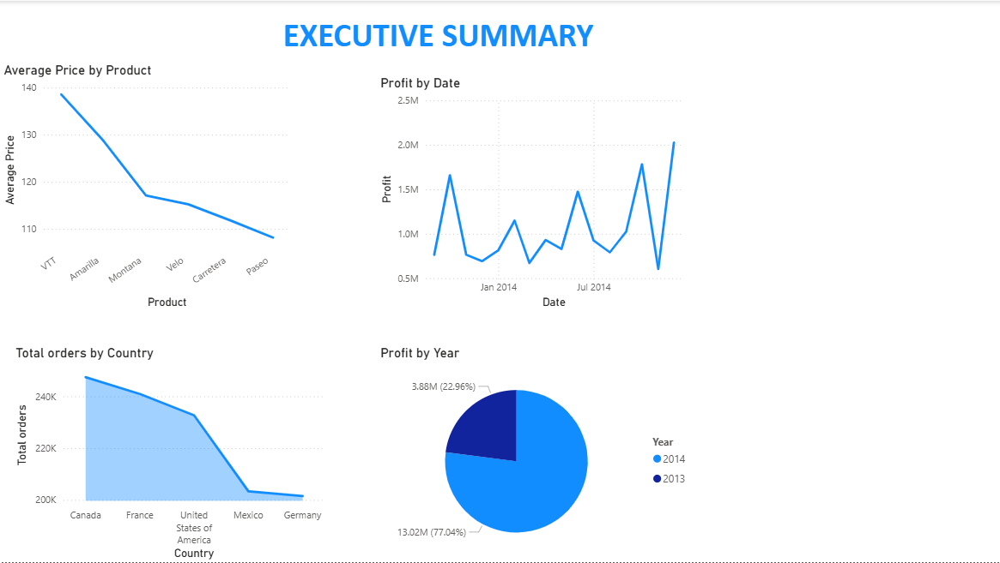

# Financial-Sales-Performance-Dashboard

##Project Overview
This basic-level Power BI project analyzes global financial sales data, over the years of 2013 and 2014 to uncover key drivers of revenue and profitability.
As a data analyst, I designed this end-to-end business intelligence solution to transform raw transactional data into actionable operational insights for regional executives and finance stakeholders.

**Note on Files:** The fully functional '.pbix' files and a complete page-by-page PDF export are available in this repository for review.

##Dashboard Features & Interactive Elements
*(As demonstrated in the animated preview above)*

